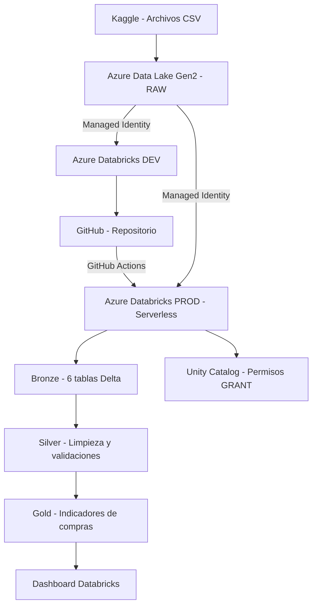

# Proyecto ETL - Supermarket Databricks

## Descripción

En este proyecto trabajé con información de compras de un supermercado, utilizando Azure Databricks y PySpark para realizar el procesamiento de datos bajo la arquitectura Medallion.

La idea fue integrar información de pedidos y productos para analizar cuáles son los más comprados, la frecuencia de recompra y los horarios en los que se realizan más pedidos.

Para esto utilicé el dataset [Supermarket Superstore Dataset Bundle](https://www.kaggle.com/datasets/amunsentom/supermarket-superstore-dataset-bundle) de Kaggle.

## Arquitectura

Los archivos CSV se cargaron en Azure Data Lake Storage Gen2, dentro del contenedor `raw`. La conexión desde Databricks se realizó mediante Managed Identity.

El procesamiento se dividió en tres capas:

- **Bronze:** se cargaron los seis archivos CSV en tablas Delta.
- **Silver:** se limpiaron los datos, se cambiaron los tipos de las columnas y se relacionaron los pedidos con sus productos. También se validaron registros duplicados y compras sin un pedido asociado.
- **Gold:** se crearon tres tablas con información resumida de productos, departamentos y pedidos por hora.

Los registros que no tenían un pedido asociado se excluyeron del análisis y se contabilizaron en una tabla de auditoría.

## Ambientes y despliegue

Utilicé dos workspaces de Databricks, uno para desarrollo (DEV) y otro para producción (PROD).

Primero trabajé los notebooks en DEV y, después de validarlos, los subí a GitHub.

Para el pase a producción utilicé GitHub Actions y Databricks Workflows. El flujo ejecuta cinco notebooks de manera secuencial: preparación del ambiente, carga Bronze, transformación Silver, carga Gold y asignación de permisos.

La ejecución se realizó utilizando Serverless. También configuré GitHub Actions para ejecutar el despliegue automáticamente cuando se modifica el código de la carpeta `proceso` o el archivo `databricks.yml`.

## Resultados

Después de aplicar las validaciones y relacionar los archivos disponibles, se obtuvieron 638,592 registros de compras correspondientes a 62,029 pedidos.

Con esta información se creó el dashboard **Supermarket - Análisis de Compras** en Databricks, que muestra los 10 productos más comprados, las compras por departamento y la distribución de pedidos por hora.

Los resultados corresponden a los registros que pudieron relacionarse correctamente entre los archivos utilizados.

## Estructura del repositorio

- `datasets`: información de los archivos utilizados.
- `proceso`: notebooks del ETL.
- `PrepAmb`: scripts de preparación del ambiente.
- `seguridad`: scripts de permisos.
- `version`: scripts de reversión.
- `dashboards`: archivo del dashboard.
- `certificaciones`: certificados relacionados con el curso.
- `evidencias`: capturas de las ejecuciones.
- `.github/workflows`: configuración de GitHub Actions.

También se incluye `databricks.yml`, donde se define el Workflow que se despliega en PROD.

## Diagrama de arquitectura

# Reversión

En esta carpeta se encuentra el script `01_reversion_prod.sql`, que permite eliminar las tablas y los esquemas Bronze, Silver y Gold del catálogo de producción.

Las tablas se crearon como tablas Delta administradas por Unity Catalog. Por este motivo, al ejecutar los comandos `DROP TABLE`, Databricks gestiona también la eliminación posterior de sus archivos físicos.

No se realiza una eliminación manual de las rutas de estas tablas. Tampoco se eliminan los archivos originales del contenedor `raw`, ya que son la fuente del ETL.

El script de reversión no forma parte del workflow normal y solo debe ejecutarse cuando sea necesario retirar los objetos del proyecto.
